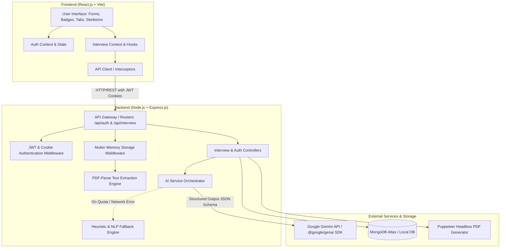

# Project Report: AI Interview Coach 🤖

---

## 1. Project Title & Executive Summary

* **Project Title:** AI Interview Coach (Intelligent Career Preparation Platform)
* **Author / Developer:** Akanksha
* **Technology Domain:** Full-Stack Web Development, Generative AI (LLMs), Natural Language Processing
* **Version:** 1.0.0
* **Repository:** `yt-gemini-project`

### Executive Summary
The **AI Interview Coach** is an end-to-end full-stack web application developed to bridge the critical gap between job seekers' qualifications and real-world hiring standards. Traditional interview preparation platforms rely on generic question banks and static guides. In contrast, this platform leverages **Google Gemini Large Language Models (LLMs)** to dynamically analyze an applicant's resume (PDF) alongside their target Job Description (JD) and professional self-summary.

The application computes role compatibility (Match Score), identifies specific skill deficiencies (Skill Gaps), curates personalized technical and behavioral interview questions with expected benchmark answers, provides interactive mock answer grading with actionable feedback, designs an adaptive 7-day preparation roadmap, and can export ATS-optimized tailored resumes in PDF format. Built on a decoupled MERN architecture with robust fallback mechanisms, the system ensures zero downtime even during API rate limits or network disruptions.

---

## 2. Problem Statement & Motivation

### The Challenge
1. **Generic Preparation Material:** Job seekers often spend days studying questions irrelevant to the specific tech stack or seniority expected by the hiring team.
2. **Hidden Skill Gaps:** Candidates frequently fail to realize missing keywords, library proficiencies, or architecture depth before entering an interview.
3. **Lack of Instant, Objective Feedback:** Practicing interview answers alone lacks validation; candidates cannot gauge whether their explanations demonstrate sufficient depth, clarity, and industry structure (e.g., the STAR method).
4. **Resume-Job Misalignment:** Most applicants send one generic resume to hundreds of disparate job descriptions, failing Applicant Tracking System (ATS) parsing.

### Project Objectives
* Automate resume and job description semantic matching using Generative AI.
* Generate targeted technical and behavioral interview questions with underlying interviewer intentions.
* Provide an interactive sandbox for candidates to type answers and receive instant scoring and qualitative feedback.
* Formulate a structured, day-by-day study roadmap focusing heavily on weak areas.
* Guarantee high system availability by integrating algorithmic fallbacks for AI services.

---

## 3. System Architecture & High-Level Design

The project employs a three-tier architecture: **Presentation Tier (React Frontend)**, **Application/Business Logic Tier (Express REST API)**, and **Data & Intelligence Tier (MongoDB & Google Gemini API)**.



---

## 4. Key Functional Modules & Features

### 4.1. Intelligent Resume & Job Description Parsing
* Accepts candidate self-descriptions and uploaded resume files (`.pdf`, `.doc`, `.docx` up to 3MB).
* In-memory file processing using `multer` and `pdf-parse` extracts clean text streams without storing temporary unencrypted files on disk.

### 4.2. Role Compatibility & Match Score Analysis
* Compares extracted candidate tokens against requirements found in the job description.
* Yields an overall **Match Score (0–100%)**, role summary, strengths breakdown, and actionable focus areas.
* Categorizes specific competencies into `strong`, `partial`, and `missing` with visual progress indicators.

### 4.3. Dynamic Question Generation (Technical & Behavioral)
* Generates role-tailored technical questions testing real-world architectural design, state management, concurrency, and security.
* Generates behavioral questions aligned with leadership and adaptability traits.
* For every question, the system provides:
  * **Question String:** The exact inquiry.
  * **Intention:** Why the interviewer asks this question and what signals they look for.
  * **Benchmark Answer:** A high-standard model response illustrating ideal depth and terminology.

### 4.4. Interactive Practice Sandbox with AI Evaluation
* Users can expand any question, draft their live answer, and submit it for evaluation.
* The backend evaluates the candidate's input against the question's intention and benchmark answer.
* Returns an objective **Score (1–10)**, a breakdown of **"What was good"**, and targeted points on **"What to improve"**.

### 4.5. Custom 7-Day Preparation Roadmap
* Creates a customized 7-day preparation schedule prioritized by the candidate’s specific missing skills.
* Progresses logically from fundamental review (Days 1–2) through project architecture (Day 3), backend/system design (Days 4–5), behavioral preparation (Day 6), to a full mock interview test (Day 7).

### 4.6. ATS-Compliant Resume PDF Export
* Re-formats candidate experience, projects, and target role keywords into an ATS-friendly single/multi-page HTML structure.
* Employs **Puppeteer** (headless Chrome) to compile standard A4 PDF downloads directly to the candidate's browser.

### 4.7. Dual-Engine Resilience (AI + Algorithmic Fallback)
* If the Google Gemini API key is unset, network drops, or rate limits (HTTP 429 `RESOURCE_EXHAUSTED`) occur, the application seamlessly activates an internal rule-based heuristic and keyword extraction engine. Users never encounter broken screens.

---

## 5. Technology Stack Breakdown

| Layer | Technology / Library | Purpose |
| :--- | :--- | :--- |
| **Frontend Framework** | React.js 19 + Vite | High-performance SPA with fast HMR |
| **Routing** | React Router DOM v7 | Client-side routing with protected route wrappers |
| **Styling & Design** | Pure CSS3 + Design Tokens | Custom component-scoped styles, themes, and CSS variables |
| **Icons & Assets** | Custom SVG sprite + Lucide | Fast rendering vector iconography |
| **Backend Framework** | Node.js + Express.js (v5) | RESTful API server handling HTTP transactions |
| **Database & ODM** | MongoDB + Mongoose (v9) | Document database for users, reports, and token blacklisting |
| **Artificial Intelligence** | `@google/genai` (Google Gemini) | LLM inference with structured Zod-to-JSON Schema outputs |
| **Validation & Schemas** | Zod + Zod-to-json-schema | Runtime type checking and LLM JSON output enforcement |
| **Authentication** | JWT (`jsonwebtoken`) + `bcryptjs` | Stateless authentication with encrypted passwords |
| **File Processing** | `multer` + `pdf-parse` | Buffer-based PDF text extraction |
| **PDF Generation** | `puppeteer` | Headless browser HTML-to-PDF rendering engine |
| **Concurrency** | `concurrently` | Unified script running both frontend and backend concurrently |
| **Deployment** | Netlify / Vercel configuration | Production serverless and SPA hosting definitions |

---

## 6. Database Schema Design (Data Models)

### 6.1. User Model (`User`)
* `name`: String (required, trimmed)
* `email`: String (required, unique, lowercased, validated)
* `password`: String (required, hashed via bcrypt with salt factor 10)
* `timestamps`: Automatically records `createdAt` and `updatedAt`.

### 6.2. Interview Report Model (`InterviewReport`)
* `user`: ObjectId referencing `User` (required)
* `jobDescription`: String (required)
* `selfDescription`: String (required)
* `resume`: String (parsed raw resume text)
* `title`: String (inferred role title, e.g., "Full Stack Developer")
* `matchScore`: Number (0–100)
* `analysis`: Embedded sub-document containing:
  * `matchScore`: Number
  * `summary`: String
  * `skills`: Array of `{ name, level, status }`
  * `strengths`: Array of Strings
  * `gaps`: Array of Strings
  * `focusAreas`: Array of Strings
* `technicalQuestions`: Array of `{ question, intention, answer }`
* `behavioralQuestions`: Array of `{ question, intention, answer }`
* `skillGaps`: Array of `{ skill, severity ('low' | 'medium' | 'high') }`
* `preparationPlan`: Array of `{ day, focus, tasks: [String] }`
* `timestamps`: Auto-tracked generation date.

### 6.3. Blacklist Model (`Blacklist`)
* `token`: String (JWT token recorded upon user logout)
* `createdAt`: Date (with TTL auto-expiration index to prevent unbounded storage growth)

---

## 7. API Specification & Endpoints

### 7.1. Authentication Routes (`/api/auth`)
* `POST /api/auth/register` — Registers a new user with encrypted password.
* `POST /api/auth/login` — Authenticates user credentials and issues a secure HTTP-only cookie with JWT.
* `GET /api/auth/profile` — Retrieves the currently logged-in user profile (protected).
* `POST /api/auth/logout` — Clears authentication cookie and adds current token to the blacklist.

### 7.2. Interview Management Routes (`/api/interview`)
* `POST /api/interview/` — Accepts multipart form data (`resume` file, `jobDescription`, `selfDescription`), generates complete analysis via Gemini or fallback, and saves report to MongoDB.
* `GET /api/interview/` — Returns all previous interview reports generated by the authenticated user.
* `GET /api/interview/report/:interviewId` — Fetches a specific interview report by its ID.
* `POST /api/interview/feedback` — Evaluates a candidate's answer for a specific question, returning score and constructive feedback.
* `POST /api/interview/resume/pdf/:interviewReportId` — Generates and streams an ATS-formatted resume PDF using Puppeteer.

---

## 8. AI Engine & Prompt Engineering Strategy

The application interfaces with Google Gemini using the `@google/genai` Node.js SDK and strict structured outputs.

### Schema Enforcement
To eliminate conversational hallucination or malformed Markdown blocks, the backend compiles a native `Zod` validation schema into JSON Schema passed via `responseSchema` and `responseMimeType: "application/json"`:

```javascript
const response = await ai.models.generateContent({
    model: "gemini-flash-lite-latest",
    contents: prompt,
    config: {
        responseMimeType: "application/json",
        responseSchema: zodToJsonSchema(interviewReportSchema),
    },
});
```

### Prompt Architecture
The prompt isolates:
1. **Context Inputs:** Candidate resume text, candidate self-summary, and verbatim job description.
2. **Evaluation Directives:** Unbiased scoring, identification of concrete missing qualifications, and extraction of role-specific requirements rather than generic questions.
3. **Structured Mapping:** 7 distinct fields mapping directly to data models (Title, MatchScore, Analysis, TechnicalQuestions, BehavioralQuestions, SkillGaps, PreparationPlan).

---

## 9. Security, Quality & Performance Considerations

1. **Defense-in-Depth Authentication:**
   * Passwords hashed with standard `bcrypt` 10 salt rounds.
   * Access tokens saved in `httpOnly`, `sameSite: none`, `secure` cookies to neutralize Cross-Site Scripting (XSS) token theft.
   * Server-side blacklist checks on protected routes protect against stale token replay after logout.
2. **CORS & Preflight Handling:**
   * Dynamic origin reflection with credential support enables seamless integration across development (`localhost:5173`) and production hosting (Netlify/Vercel).
3. **Memory Safety & Resource Management:**
   * In-memory file buffer processing prevents disk exhaustion.
   * Puppeteer browser instances are safely closed within `finally` blocks to prevent zombie Chrome processes.
4. **Optimistic & Resilient UI:**
   * Custom Skeleton loaders provide visual continuity while the AI processes heavy inference jobs.
   * Clean separation between Tabs (`Technical Questions`, `Behavioral Questions`, `Results & Feedback`, `Preparation Roadmap`).

---

## 10. Local Setup & Execution Guide

### Prerequisites
* Node.js v18+ or v20+
* MongoDB running locally or a MongoDB Atlas connection URI
* Google Gemini API Key from Google AI Studio

### Step 1: Clone and Install
```bash
git clone https://github.com/akankshama97/yt-genai-project.git
cd yt-gemini-project
npm install
```

### Step 2: Environment Variables Configuration
Create a `.env` file in the `Backend/` directory:
```env
PORT=3000
MONGODB_URI=mongodb://127.0.0.1:27017/ai-interview-coach
JWT_SECRET=your_super_secret_jwt_key
GOOGLE_GENAI_API_KEY=your_gemini_api_key_here
GEMINI_MODEL=gemini-flash-lite-latest
```

### Step 3: Run the Application
From the root directory:
```bash
npm run dev
```
* **Frontend Client:** `http://localhost:5173`
* **Backend API Server:** `http://localhost:3000`

---

## 11. Results, Achievements & Future Enhancements

### Key Achievements
* **100% End-to-End Functional Pipeline:** From raw PDF upload to live AI question-and-answer evaluation.
* **Fail-Safe Operation:** Dual-engine architecture guarantees zero downtime even if Google Gemini API hits rate limits.
* **Rich User Experience:** Fast interactive UI with detailed score cards, progress bars, and roadmap tracking.

### Future Scope
1. **Speech-to-Text & Audio Mock Interviews:** Integrating Web Speech API / Whisper so candidates can practice speaking their answers aloud.
2. **Video & Body Language Analysis:** Real-time webcam analysis measuring eye contact, pacing, and confidence.
3. **Coding Execution Sandbox:** In-browser code runner (Monaco editor + isolated Docker runner) for live coding interview tests.
4. **Company-Specific Interview Profiles:** Pre-tuned interview benchmarks tailored to specific target companies (e.g., Google, Amazon, Microsoft).

---

## 12. Conclusion

The **AI Interview Coach** represents a modern, production-grade implementation of Generative AI in the career tech space. By marrying the power of **Google Gemini** with structured schema guarantees, resilient backend engineering, and an intuitive user interface, the project provides candidates with an accessible, high-impact tool to maximize interview success.
